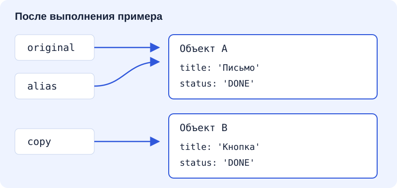

# Массивы и объекты: выбрать данные и сохранить исходник

**Результат:** вы выбираете заявки по статусу и строите подписи, не изменяя входные данные. Нужны [значения, функции и условия](/lessons/w1-03). Это первое упражнение с автоматическим отчётом; объяснение результата остаётся отдельной частью работы.

## Рабочая ситуация и прогноз

Список нужен одновременно двум частям интерфейса: одна показывает все заявки, другая — только открытые. Если фильтр незаметно изменит исходный массив, первая часть тоже начнёт терять данные.

```js
const original = { title: 'Письмо', status: 'OPEN' };
const alias = original;
alias.status = 'DONE';
const copy = { ...original, title: 'Кнопка' };
console.log(original.status);
console.log(original === alias, original === copy);
```

До запуска назовите статус и два логических результата. Затем подумайте, изменится ли ответ, если написать `let` вместо `const`. Важно понять устройство значений, а не запомнить удобный синтаксис копирования.

## Объект и ссылка

Объект объединяет именованные свойства: `id`, `title`, `status`. Доступ `issue.status` читает свойство, присваивание меняет его. Массив хранит упорядоченную последовательность значений: первый элемент имеет индекс 0, число элементов доступно через `length`. Литерал `[]` создаёт массив, `{}` — объект. В массиве заявок каждый элемент является объектом со своими свойствами.

При присваивании объекта переменной не создаётся независимый второй объект. Значение позволяет обратиться к тому же объекту; поэтому через `alias` и `original` мы видим одно состояние. В прогнозе вывод будет `DONE`, затем `true false`. Запрет повторного присваивания `const` не запрещает менять свойства объекта. Замена на `let` сама по себе ничего не скопирует.



На схеме две верхние стрелки сходятся к объекту A: изменение через любую из этих переменных видно через другую. Нижняя стрелка ведёт к новому объекту B, созданному spread. В этом примере свойства содержат строки; о вложенных объектах поговорим ниже.

Сравнение `===` для объектов отвечает на вопрос об идентичности: это один объект или разные? Два отдельно созданных `{id: '1'}` не равны через `===`, хотя значения их полей совпадают. Для строк статуса `===` сравнивает строковые значения. Не переносите на объекты ожидание «сравнить все поля автоматически». При проверке содержимого в тестах позже используем специальное глубокое сравнение.

Оператор spread, запись `...original` внутри нового объекта, переносит собственные перечисляемые свойства в новый объект. Последующие свойства перекрывают предыдущие: `{...original, status: 'DONE'}` получает новый статус. Это поверхностная копия: вложенный объект вроде `assignee` остаётся общим. Аналогично `[...issues]` создаёт новый массив, но не новые заявки внутри него. Для нашей плоской модели достаточно копировать ровно тот уровень, который меняется; глубокое копирование всего подряд не является обязательной целью.

## Три операции с разными результатами

`filter` возвращает новый массив элементов, для которых функция-предикат дала `true`. Предикат — функция, отвечающая «подходит ли элемент». Пример `issues.filter(issue => issue.status === 'OPEN')` сохраняет исходный порядок. Стрелка `issue => ...` описывает функцию с одним параметром и неявным возвратом выражения. Если добавить фигурные скобки тела, потребуется явный `return`; иначе результатом станет `undefined`, и фильтр ничего не оставит.

`map` возвращает новый массив результатов преобразования. Он подходит для подписей: каждый объект становится строкой. Шаблонная строка в обратных кавычках подставляет выражение из `${...}`. Длина результата map равна длине исходника, даже если преобразование возвращает пустую строку. `find` ищет первый подходящий элемент и возвращает сам элемент, а при отсутствии — `undefined`. Это другой контракт, чем массив из filter. Не вызывайте свойства результата find, пока не разобрались с отсутствием.

Эти методы не изменяют массив сами по себе, но переданный callback может изменить объект. `issues.map(issue => { issue.status = 'DONE'; return issue; })` мутирует заявки, несмотря на новое имя результата. Неизменность определяется действиями вашей функции, а не названием метода. Для обновления одной заявки обычно возвращают копию изменяемого объекта, остальные оставляют прежними.

`null` часто явно обозначает «значения нет», `undefined` появляется при отсутствии свойства, результата или совпадения find. Это разные значения; `null === undefined` даёт `false`. Пока не заменяйте все проверки сокращением `if (!value)`: оно также отвергает 0, пустую строку и false. Выбирайте условие по контракту данных.

## Мост от Java

Ссылки на объекты ведут себя знакомо: два имени могут обращаться к одному изменяемому экземпляру, а `final`-ссылка в Java не делает экземпляр неизменяемым. `const` помогает той же интуиции, но не совпадает со всеми правилами Java final. `filter` и `map` напоминают операции Stream, однако у массива JavaScript они сразу выполняются и сразу возвращают массив. `find` возвращает значение или undefined, не Java Optional. Внешняя JSON-заявка не обязана иметь нужные поля: к этому вернёмся в TypeScript.

## Разобранный пример

В корне выполните `node practice/foundations/web-basics/examples/arrays.mjs`. Файл содержит отдельные демонстрационные функции, не ваше решение. Ожидается:

```text
[{"id":"1","title":"Письмо","status":"OPEN"}]
["1: Письмо","2: Кнопка"]
OPEN IN_PROGRESS
undefined
```

JSON.stringify превращает массив в текст для однозначного вывода. Первая операция выбирает открытую заявку, вторая строит подписи, третья через map заменяет только объект с id `1`. Исходный статус остаётся OPEN, новый становится IN_PROGRESS. Последняя строка — отсутствие id `9`. Измените искомый id на `2`: find теперь вернёт существующий объект. Верните пример после эксперимента.

## Практика в IDE

Упражнение `w1-04-ex1`: редактируемый файл `practice/foundations/w1-04-ex1/solution.mjs`. Сохраните именованные экспорты, чтобы runner мог импортировать функции. Реализуйте два контракта:

- `filterIssues(issues, status)` возвращает новый массив только с точным статусом `status`, в исходном порядке. Объекты выбранных заявок остаются теми же; копировать их для этой операции не нужно.
- `labelIssues(issues)` возвращает строки формата `id: title`, например `1: Письмо`, в исходном порядке.

Обе функции работают с пустым входом и не изменяют массив или объекты. Вход по условию является массивом корректных заявок; проверка произвольного JSON здесь не требуется. Не подменяйте вход тестовыми данными внутри функций. Запустите `npm.cmd run learn -- check w1-04-ex1`, затем импортируйте созданный JSON из `practice/reports/` на странице урока. На PowerShell допустимо `npm.cmd run learn -- check w1-04-ex1`.

<a id="criteria"></a>
## Критерии

Обязательные проверки: `filter-open` — корректный выбор статуса и порядок; `immutable-input` — входные данные сохранены; `empty-list` — пустые массивы дают пустые результаты; `labels` — точные подписи. Нетронутая заготовка не проходит проверку. Ошибка запуска инструмента и неверный результат функции — разные исходы.

Отчёт описывает код в момент запуска: после дальнейшего изменения повторите команду. Успех проверок подтверждает опубликованный контракт. Дополнительно вручную объясните ссылки и новую вариацию; это нельзя вывести из зелёного результата автоматически.

## Подсказки

<details><summary>1. Определите форму результата</summary><p>У первой функции элементы результата остаются заявками; у второй становятся строками. Выберите между filter и map по этому различию.</p></details>
<details><summary>2. Найдите скрытую мутацию</summary><p>Проверьте все присваивания свойствам, push, splice и sort. Для выбора и подписей ни одно из них не требуется.</p></details>
<details><summary>3. Короткий синтаксический образец</summary><p><code>numbers.filter(number =&gt; number &gt; 0)</code> выбирает числа. Замените условие на проверку нужного поля заявки, сохранив контракт аргументов.</p></details>

## Проверка понимания

1. Почему новый массив после filter содержит прежние объекты?
2. Что будет с результатом find, если id отсутствует?
3. Почему map не гарантирует отсутствие мутации внутри callback?
4. Чем const отличается от неизменяемых данных?

Новая вариация: независимо от зачётной функции напишите преобразование, меняющее только статус заявки с заданным id. Проверьте исходник и объясните, какой уровень скопирован и почему.

## Источники

- [MDN: Array.filter](https://developer.mozilla.org/en-US/docs/Web/JavaScript/Reference/Global_Objects/Array/filter) — проверить контракт выбора и поверхностного результата.
- [MDN: Array.map](https://developer.mozilla.org/en-US/docs/Web/JavaScript/Reference/Global_Objects/Array/map) — уточнить преобразование каждого элемента.
- [MDN: spread](https://developer.mozilla.org/en-US/docs/Web/JavaScript/Reference/Operators/Spread_syntax) — изучить границы поверхностного копирования.
